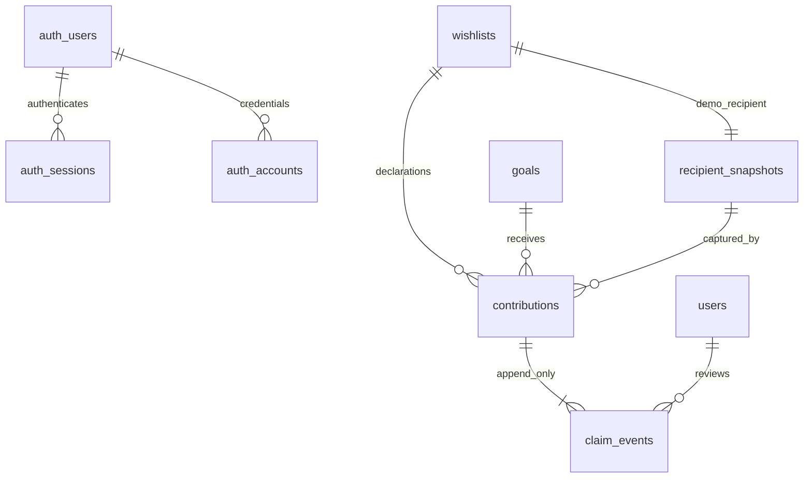

# Current increment: smoother onboarding and consistent interactions

This supersedes checkpoint-1 statements that auth/reports were absent or that a shared fictional account could be entered. The release target remains a hosted responsive wedding app, **not yet production ready**.

## What changed and why

The user selected a no-gateway direct-to-couple direction: guests declare a payment amount after using UPI, rather than the platform collecting money. A plain QR/redirect/reference/screenshot provides no trustworthy receipt event to this application. Without an approved bank/provider integration, receipt confirmation must remain the couple's manual bank-record check.

The runnable local workflow now implements separate accounts and **synthetic** reporting/confirmation, without a hosted identity, payment, mail, AI or analytics API. It does not generate a real payable UPI QR or process money. Demonstration QR payloads start `DEMO-NOT-PAYABLE|`; wishlist-link QR codes still contain only the local guest URL.

## PostgreSQL implementation - 19 November 2026

The backend now actually uses PostgreSQL **18.7** through **pg/@types/pg 8.23.1**, not SQLite or an emulation. Node **26.13.0** reports LTS **Lithium**. Official EDB Windows binaries run independently of Next on `127.0.0.1:55432`; no shared Windows service, Docker daemon or cloud account was used. Archive SHA256 recorded at download: `EAD0BBC27FB678FA24DCF86B738981323042ABD073C744103BF7F3AED23F9A33` (local fingerprint, not an independently published authenticity attestation).

`data\local-postgres.json` contains generated local credentials; `data\postgres-cluster` holds durable database files. Both are ignored. Schema-owner/migration and app roles are separate. Startup rejects privileged app roles. Tested runtime restrictions deny table creation, trigger disabling, migration-history updates and ledger deletion. Administrators/filesystem owners remain trusted; these are not tamper-proof controls against them.

Current SQL is in `migrations\postgres`: atomic advisory-locked migration application, generated maintained-library auth schema, and an additive fix allowing absent optional timestamps. Migrations refuse unrelated or mismatched-environment databases. Old SQLite files/migrations are historical and remain untouched; no production-data conversion is claimed.

Money uses exact integer-paise NUMERIC values with integral/bounds constraints (no PostgreSQL rounding of fractional paise), converted to JS only after safe-integer checks. Domain timestamps are validated, consistently UTC ISO text; auth uses TIMESTAMPTZ. Queries are parameterized. Remote connection configuration enforces certificate verification even when a URL says `sslmode=require`; disabling TLS verification is rejected.

Transactions use PostgreSQL row/advisory locks, not a process-local mutex. Tests exercise eight simultaneous same-key reports, racing confirmations, duplicate references, slug collisions, stale versions and atomic rate buckets. Deferred constraints reject cache/ledger divergence at commit.

Native `pg_dump` uses an exported repeatable-read snapshot. The automated drill restores into a freshly generated local test database and checks counts, marker and ledger/state reconciliation before dropping only that isolated database. A separate test fills auth/accounts/mailbox plus a confirmed gift/event history before exercising this restore. Backups stay private/local; encrypted off-instance/PITR recovery is still a launch requirement. Reset switches to a new marked synthetic database and preserves the previous one.

## Authentication

Better Auth **1.7.21**, MIT, stable version selected from registry versions because `latest` was a beta. Official docs verified:

- https://better-auth.com/docs/installation
- https://better-auth.com/docs/adapters/postgresql (supported direct Pool adapter)
- https://better-auth.com/docs/authentication/email-password
- https://better-auth.com/docs/concepts/database (programmatic migration API)

The executed `getMigrations(auth.options).compileMigrations()` supplied `migrations/postgres/002_auth.sql` from a real PostgreSQL connection. Real library handlers manage password hashing, verification, sign-in/sign-out, expiry, recovery and session revocation. Telemetry is explicitly disabled. No hand-rolled password protocol or default administrator credentials.

Local rules: fictional `@example.test` registrations only; 12-128 character passwords; verified email required; generic sign-in/recovery UI and enumeration-resistant signup; sessions one hour with library cookie caching disabled. Cookies are HttpOnly/SameSite=Strict, **not Secure on local HTTP**. Signing out/recovery revokes persisted sessions. Per-email and global database-backed application rate buckets complement library limits.

Local verification/recovery use a private `auth_local_outbox` table. **No email is sent.** `npm run auth:mailbox` is a terminal-only credential viewer, never an HTTP endpoint. Links expire under the auth library; new enqueue operations purge outbox rows older than one hour. The launcher generates a persistent secret in ignored `data\local-auth-secret.txt`, never prints it, and passes it server-side. On Windows, POSIX file modes do not substitute for reviewed account/ACL isolation. This local delivery/secrets setup must not be publicly exposed.

`/api/demo-session` POST is retired (410). Old seeded wishlists are not silently transferred to newly registered owners. Application identities in the demo remain marked synthetic; auth identities are separately stored and mapped by immutable ID, not display name. Legacy SQLite accounts have not been silently imported into the new PostgreSQL demo.

### Production identity increment

Implemented separate exact-origin HTTPS configuration, Secure/HttpOnly/SameSite=Strict cookies, real-account identity mapping, mode-aware authentication messages and a fail-closed `start:production` entrypoint. Root runtime connections check environment markers and reject administrator/schema-owner privileges before queries; the auth library's direct Pool access waits for this same check. Local and production modes cannot be combined. Public payment surfaces remain explicitly synthetic; production auth configuration is **not product launch readiness**.

Migration 004 adds an encrypted authentication-email outbox and persistent UTC delivery-attempt budgets. AES-256-GCM protects queued recipients and private credential links using an independent server key and authenticated job metadata. Final payloads are cleared, finalized metadata is pruned after seven days during worker invocations, and processing expires verification/recovery jobs earlier than the auth library's tokens. Inactive workers delay cleanup. This does not encrypt the entire database/library session tables or defend against a compromised application server.

The fixed-endpoint Resend adapter is implemented but **no provider account, verified sender, real key, scheduler or email delivery is configured**. Explicit approval/sender/key gates precede database use in its CLI. Provider signatures/webhooks are not relevant to this outbound email adapter, and no tracking webhook/pixel was added. Official API and 24-hour idempotency documentation:

- https://resend.com/docs/api-reference/emails/send-email
- https://resend.com/docs/dashboard/emails/idempotency-keys

One job per `auth:deliver` invocation, row locks/expiring leases/fencing tokens, immutable encrypted request bodies, persisted idempotency keys, bounded retries/backoff and maximum five attempts handle uncertain acknowledgements/crashes. `accepted` means a provider ID was acknowledged, not inbox delivery. Exhausted uncertain outcomes remain `unknown`. Atomic budgets conservatively count retries too, stopping at 90 attempts/day and 2,700/month. They cannot control other applications/manual account usage or establish the provider's actual billing settings. Approved dedicated free-plan setup and supervised worker invocation at least once per minute remain launch gates.

Actual tests use real PostgreSQL/restricted roles and a **local mocked transport**, including concurrent workers/enqueues, retry after lost acknowledgement with identical provider key/body, worker crash/lease fencing, daily/monthly quota races, expiry, corrupt ciphertext, rejected/rate-limited/unavailable provider responses, malformed success, HTTPS verification and single-use recovery with session revocation. No actual provider delivery is claimed.

## Actual migrated ER additions

PostgreSQL migrations execute atomically. They include library auth tables/indexes, a local mailbox, immutable recipient snapshots/contribution terms and append-only claim-event triggers. Composite foreign keys enforce goal/recipient/wishlist consistency. All money stays integer paise and INR.

Recipient snapshots in this demo contain only a label copied from the fictional couple name, not a UPI address or payment instrument. Real setup, recipient-name confirmation, reauthentication and versioned recipient changes remain unimplemented.

## Live direct-UPI vertical slice - 19 November 2026

Migration **006** adds immutable per-wishlist `recipient_versions` (syntax-checked UPI ID and
label; syntax is never ownership verification) and a reviewed one-way live activation. Owner
recipient creation and activation require a session authenticated within the last ten minutes
(403 REAUTH_REQUIRED otherwise), an exact UPI ID re-entry and an explicit acknowledgement.
Activation is one transaction with an audit entry, allowed only while a wishlist holds zero
reports: a wishlist with existing demo reports can never become a live-payment wishlist, and
live mode cannot be reversed or switched to any other mode (database trigger and app check).
The only implemented live funding policy is allow-overfunding with truthful totals, chosen
explicitly per activation; product-level policy approval remains a release gate.

All live payment behavior is server-enforced off by default: activation is rejected with
503 LIVE_PAYMENTS_DISABLED unless the operator sets LIVE_UPI_APPROVED=yes after the owner's
explicit approval. The variable is an attestation, not a switch: it cannot create or bind
recipient instructions, convert demo history, or activate any wishlist by itself, and an
inexact value does not open the gate. The gate covers existing live rows too: with the gate
unset or inexact, the guest projection of a live wishlist carries no payable instructions
(liveRecipient is null, so no UPI ID reaches the page or API), the guest UI shows a
payments-unavailable notice instead of any pay/report flow, and new live reports are refused
with 503. Existing private receipts still replay and the guest status lookup keeps working;
the owner's own view of their live setup is unchanged.

Guests holding an older instruction version get 409 STALE_RECIPIENT and must refresh. A live
wishlist paused after a guest already paid still accepts that late report, forced into
`needs_review` with an explicit late reason; closed collections accept no new reports, and
idempotent private receipts replay across pause/closure in both modes. Live reports bind the
recipient version, never a demo snapshot; confirmation uses the same append-only ledger. No
QR, upload, screenshot or payment-link pipeline exists, and no money is collected or verified.

Focused validation on PostgreSQL 18.7 (Linux): 140 unit/integration tests across 12 files
passed, including nine new recipient/activation/gate/stale/late-report/ledger cases, plus
lint, type-check and optimized build on Node 24.22.3. Browser journeys were not re-run for this
increment; demo-flow wording used by existing e2e selectors is unchanged. No hosted
activation, real recipient, real payment or deployment was performed.

## Report invariants and states

Amount INR 1 to INR 1,00,000; plain decimal strings with at most two places. Currency mismatch/unknown fields rejected. Optional bounded name/message/reference. A report's amount/goal/currency/recipient/guest text cannot later be edited silently.

A random 256-bit key serves as private status capability and idempotency key. Only its SHA-256 hash and a canonical request hash are stored. Same key/same terms returns the same report, even after a later pause/closure; same key/different terms is 409. This is not permission to initiate a new transfer on retry. The browser stores only that key in sessionStorage for tab-scoped refresh/retry, not name/message.

| From | Allowed next | Confirmed delta |
|---|---|---|
| new declaration | reported, or needs_review for duplicate reference | 0 |
| reported | needs_review, rejected, owner_confirmed | +amount only when confirmed |
| needs_review | rejected, owner_confirmed | +amount only when confirmed |
| owner_confirmed | needs_review | -amount (audited reversal, not a refund) |
| rejected | needs_review | 0 |

Review needs a server-verified authenticated owner, expected version and reason. Confirmation additionally requires an explicit acknowledgement flag. The browser checkbox is not the sole enforcement. Stale/repeated state changes fail; no silent balance adjustment or fake refund button.

Confirmed public demo progress is derived by summing immutable claim-event deltas per goal. Pending/rejected/review reports add zero. Individual names, messages, references and amounts never appear in the public projection. Aggregate changes can still reveal/infer an amount when few gifts exist; no absolute anonymity claim.

Demo overfunding is explicitly simulated: actual confirmed totals remain visible and only the visual bar caps at 100%. **Live hard-cap/overfunding policy remains undecided.**

## Current equivalent API contract

All application mutations still require exact Host/Origin, JSON and a bounded request body. Owner responses are no-store; all pages noindex/no-referrer. Auth verification/recovery links are library-managed token-protected GET ceremonies; app state changes remain POST/PATCH. Next incoming-request logging is disabled to reduce verification/recovery URL leakage; reverse-proxy/host logs still need separate production review.

| Endpoint | Contract |
|---|---|
| `/api/auth/*` | Maintained Better Auth routes, server origin/body/rate guards. Local signup restricted to synthetic email addresses; approved HTTPS identity uses queued verification. No remote profile image |
| POST `/api/public/wishlists/{slug}/reports` | `{goalId,recipientSnapshotId,amount,currency:"INR",guestName?,guestMessage?,reference?,token}`; validated 256-bit key; returns own receipt/status; no auth required |
| POST `/api/guest/status` | `{token}`; scoped receipt only or uniform 404 for invalid/expired key; max 7-day status capability |
| GET `/api/owner/wishlists/{id}/reports?status=all&page=1` | Owner-only, 50 rows/page plus separate reported/review/owner-confirmed/rejected totals |
| PATCH `/api/owner/wishlists/{id}/reports/{claimId}` | `{status,version,reason,acknowledged?}`; acknowledgement true required for confirmation |
| GET `/api/owner/wishlists/{id}/reports/export` | Owner-only private CSV, up to 5,000 rows, fail rather than partial output above limit; formula-prefix neutralization plus CSV quoting |
| POST `/api/demo-session` | 410, no access grant |

Receipt fields: `id,status,amountPaise,currency,goalTitle,recipientLabel,tokenExpiresAt,mode:"demo"`. Owner list additionally includes optional private guest fields, duplicate-reference warning, version and created UTC. Unknown fields/invalid amount: 422; unavailable/stale/key-conflict: 409; no auth: 401; cross-owner/nonexistent: 404; origin denied: 403; rate limit: 429 with Retry-After.

Private URLs use `/gift-status#<random-key>`: fragment not sent in the server URL. The page reads it only when requested, removes it from the visible URL and uses POST for lookup. The current key is retained in this tab's session storage for reloads; the forget action clears it and matching per-goal retry copies, not the server report or original link. No service worker, analytics or remote QR service. Anyone possessing the key can view that one receipt; it must stay private.

## Current requirements-to-tests delta

| IDs | Scenario | Expected | Level | Actual latest completed run |
|---|---|---|---|---|
| AUTH01 | Registration/duplicate signup/unverified login | Generic signup shape, no sign-in before verification; hash not plaintext | Real library + PostgreSQL integration | PASS |
| AUTH02 | Verified sign-in/sign-out/expiry/forged cookie | Persisted-session checks; immediate revoke; expired/invalid denied | Integration | PASS |
| AUTH03 | Recovery/reused token/old session | One successful reset; replay and old session denied | Integration | PASS |
| AUTH04 | Owner A vs B reads/edits/reports | 404 without disclosure | Real separate-account HTTP E2E | PASS |
| CLAIM01 | Unverified report | Pending grows; confirmed stays zero | Unit/integration/E2E | PASS |
| CLAIM02 | Retry/same key/conflicting terms | One record/effect; conflict not duplicate | Integration + concurrent HTTP E2E | PASS, including simultaneous retries |
| CLAIM03 | Duplicate/forged reference | Review warning only; never verifies | Integration | PASS |
| CLAIM04 | Wrong goal/recipient/currency/amount | Reject server-side/constraints | Integration | PASS |
| CLAIM05 | Confirmation/double-confirm/reversal/rejection | Exact audited delta; no negative/double count | Integration/E2E | PASS |
| CLAIM06 | Scoped/random/expired guest token | Own receipt only, 404 otherwise | Integration/E2E | PASS |
| CLAIM07 | Immutability | Terms/recipient/event overwrite/delete denied | Integration | PASS |
| CLAIM08 | CSV formula injection | Dangerous leading formula/whitespace quoted and neutralized | Unit + real CSV endpoint E2E | PASS |
| UI02 | Mobile/desktop, 320/390/768/1280 owner forms, session loss/offline | No checked horizontal overflow; form preserved; report->review->confirm->status works | Browser E2E | PASS |
| ACK01 | Confirmation without explicit acknowledgement | 422, no state change | Browser HTTP E2E | PASS |

PostgreSQL checkpoint validation: lint/typecheck passed; **82 unit/integration tests in 6 files passed** in the final combined run; optimized build and **6/6 desktop/mobile E2E passed against a restricted PostgreSQL role** after the private-notice/external-driver changes. Native seed and main-database snapshot/restore also passed. A controlled termination/restart of this project's PostgreSQL process preserved the baseline row counts and returned a writable primary. This tests process restart, not high availability, power-loss guarantees or disk-loss recovery. No physical-device UPI test, full WCAG assessment or independent completed-code security assessment is claimed.

Latest identity-increment validation: lint/typecheck and optimized build passed. A combined **101-test/8-file** suite passed before the final three added guard tests; the final focused config/HTTP/email runner passed **29/29**, including those three and HTTPS recovery. Four browser cases passed initially; the other two found an outdated assertion of intentionally changed session-expiry text. After correcting that selector, **2/2 targeted desktop/mobile cases passed**. No unresolved browser failure is hidden as a successful full-suite run.

A fresh `npm audit --omit=dev --audit-level=low` completed with **0 reported production dependency vulnerabilities** for this lockfile. The earlier HTTP 429 is historical; this audit does not cover development dependencies or prove application security.

A read-only security-review agent inspected the auth/email increment and immediate integration, reporting **no vulnerabilities identified in the scoped changes**. This is not a full-product penetration test or a security guarantee. Unverified assumptions: deployed Host/Origin/TLS/no-cache behavior; correctly provisioned production DB marker/role; actual provider idempotency/acknowledgements/live delivery. No tests or deployment were executed by that reviewer.

| # | Severity | File | Lines | Vulnerability | Confidence |
|---|----------|------|-------|---------------|------------|
| - | - | Auth/email increment | - | No vulnerabilities identified in scoped review | - |

Persistent preview was restarted and checked in Chromium: home/owner/seeded guest HTTP 200, anonymous owner API 401, retired shared entry 410, no observed hydration errors or checked mobile horizontal overflow. Desktop home, mobile guest and 320px owner screenshots were inspected. The URL remains `http://127.0.0.1:4317`, accessible only on this computer, not public hosting.

Hosting research found an additional runtime gate: [Netlify](https://docs.netlify.com/build/functions/configuration/?fn-language=js#node-js-version-for-runtime) bases its function runtime on Lambda and documents Node 24 fallback; [AWS](https://docs.aws.amazon.com/lambda/latest/dg/lambda-runtimes.html) currently labels its Node 26 runtime **preview, not for production**, even though this computer's Node 26 language release is LTS. Local Node 24 compatibility is now tested below; hosted OpenNext compatibility is not. Netlify's default function region is Ohio and region customization is documented as Pro/Enterprise; no free India-only residency is assumed.

## Stable hosting runtime and script-policy increment

The project now pins **Node 24.22.3 LTS Krypton**, npm **11.19.1** and matching **@types/node 24.19.2**. The official portable Windows archive matched the official SHA256 manifest (`E612AF99F626AB415EA225AF6BCE5C971FEB448CB5CAE250BB1C3FA50C5F7D9F`). It is isolated under user-local tooling, not a machine-wide Node change. `.node-version`, engines and the actual npm lockfile agree.

On this actual runtime, lint/typecheck, **104/104 unit/integration tests in 8 files**, optimized build and a complete **6/6 desktop/mobile browser run** passed; production dependency audit reported zero advisories. This includes real PostgreSQL, native restore and HTTPS-library verification/recovery. Known ESLint plugin peer-range warnings remain; their installed lint command passes.

Subsequent CSP hardening follows the [official Next.js nonce/dynamic-rendering guidance](https://nextjs.org/docs/app/guides/content-security-policy): cryptographically random 128-bit nonce per request, matching request/response CSP, strict-dynamic, and no script unsafe-inline/eval in optimized builds or production app mode. All pages, including recovery/private-status/not-found, are dynamically rendered so nonce-bearing HTML is not statically reused. Production-mode responses additionally send HSTS. Development eval and the exact loopback HMR WebSocket origin are allowed only in explicitly local development.

Inline **styles** remain permitted for React progress widths and existing styling; no claim of an all-directive strict policy. Per-request SSR also increases compute use and forfeits static HTML/CDN caching; free hosting quotas must account for that. No external CSP reporting collector/analytics is configured.

After CSP changes, focused proxy/HTTP tests passed **10/10**, lint/typecheck and optimized build passed. Four browser cases passed initially; the two updated gift journeys then passed on desktop/mobile after making the injection check operate on actual HTML before browser parsing rather than a DevTools-executed probe. These tests check browser-enforced blocking of a non-nonced parser-inserted script, matching framework nonces and a complete hydrated account/QR/report/confirmation journey. A separate actual Node 24 development-server check passed: interactive account form, received HMR WebSocket frame and zero observed page errors. Its temporary server was stopped.

## Goal-management increment

Implemented owner-only add/edit/reorder/archive/restore APIs and responsive controls. Every
mutation checks a current wishlist version and bounded private reason; closed, archived or
expired wishlists reject changes. The limit is 20 retained goals including archived goals,
not 20 active goals with silently discarded historical records. SQL row locks serialize
goal changes, report creation and manual confirmation; concurrent stale writes fail.

Additive migration 005 adds archive state, per-goal versions, deferred position uniqueness,
append-only history and automatic owner/reason/snapshot triggers. Existing goals receive an
explicit migration baseline, not fabricated historical authorship. Goals and history cannot
be hard-deleted through the supported runtime. Applied migrations 001-004 are unchanged.

Any guest report freezes goal title/description, including reports later rejected. Target
changes after reports require explicit acknowledgement and cannot reduce the target below
current net confirmed progress. Later confirmations can still produce truthful demo
overfunding. Archiving blocks new reports but preserves existing private retries, reviews
and confirmed totals; restoring enables fresh reports again. Target changes remain publicly
visible (latest 20 per goal), without private reasons/actors. Owner history displays the
latest 100 full changes, explicitly retaining older database rows.

The owner UI uses fresh server props after refresh without silently overwriting unsaved
forms. Editing captures an optimistic version; adopting a newer version requires an explicit
review action. Offline and expired-session errors preserve form inputs. Keyboard move
buttons support reordering without dragging. Native restore now checks goal/revision
snapshots as well as table counts and financial balances.

Actual Node 24 validation: **122/122 unit/integration tests across 10 files**, **8/8
desktop/mobile browser journeys**, lint, type-check and optimized build passed. Tests cover
restricted-runtime triggers, migration-4 baseline backfill, transactional rollback, tenant
isolation, stale versions, report/archive and confirmation/target races, bounded projections,
mobile layouts down to 320px, private-history non-disclosure and offline/session failures.
No new full-product security review, real device, live UPI or hosted delivery is claimed.

## Web readiness and independently scoped worker increment

Implemented `GET /api/health/ready` with non-sensitive status/correlation IDs and redacted
503 failures. It checks valid auth/email configuration, actual PostgreSQL liveness,
environment/role/minimum schema and every required web permission. Guarded runtime pools
also enforce minimum schema, including when a serverless adapter bypasses the standalone
startup script. Permission checks use the same grant definitions as migration provisioning.

Extracted a shared email-worker runner for the CLI and prepared Netlify scheduled function.
Each invocation opens/closes its own pool and handles at most one leased job. Approval,
credentials, environment, minimum schema and email-only role checks precede provider calls.
The worker does not need the auth signing key and refuses the broad web role.
`DATABASE_EMAIL_ROLE` optionally provisions a distinct pre-created role with metadata reads
and outbox/budget operations only, not account/financial access.

Separate Netlify package configurations and a static worker-only notice are under `deploy`.
No extra dependency, provider enrollment or resource was added; the nested worker manifest
only identifies its framework-free package while root installs use the existing lockfile.
Generated `.netlify` artifacts are ignored. Current official Netlify docs support minute UTC
scheduling, a 30-second execution limit and no direct production URL invocation for scheduled
functions. These platform behaviors still require actual approved hosted verification.

**Free-tier fit is not established:** minute database polling can defeat Neon scale-to-zero
and exhaust free compute even with little email. The operations guide now requires combined
web/worker/database budget and hard no-spend review, and records Supabase's standalone
PostgreSQL Free plan as an additional untested candidate. Neither provider is provisioned.

Actual final Node 24 validation: **127/127 tests across 11 files**, **8/8 desktop/mobile
browser journeys**, lint, type-check and optimized build passed. Both TOML configurations
parse and the worker passes native syntax checks. Browser tests revoke only an isolated
E2E role's goal permission, verify real HTTP 503/redacted output, restore permission and
observe HTTP 200 again. Local mocked email verifies least-privilege delivery, pool cleanup
and fail-closed configuration. No real email, hosted bundle, scheduler, public URL or
payment activation is claimed.

## Onboarding, customer walkthrough and interaction consistency increment

Reproduced the reported signup friction with a failing browser regression: successful
registration kept showing the registration form, with verification instructions far below
the main action. Added a dedicated verification step, a prominent continue-to-sign-in
button, retained email, cleared passwords, verification resend and actionable link-error
feedback. Verification is still mandatory; no automatic verification or public mailbox
endpoint was introduced. Resend keeps the maintained library's generic anonymous response
for missing, verified and eligible accounts.

The engineering/product/design pass was a heuristic walkthrough of implemented journeys
and the user's reported confusion, not customer interviews. The responsive onboarding
layout puts the form first on small screens, reduces technical copy and exposes private
mailbox instructions on demand. Password controls are shared with recovery. Added owner
section navigation, a single main heading, field-error associations and modal focus
restoration. Removed the homepage's unconditional link to a potentially absent seed.
Close/archive and confirmation reversal now require an explicit confirmation dialog.

Sign-in returns to the requested owner wishlist using only a validated exact internal UUID
path. Account changes reset old workspace state; the pending account does not see another
account's saved-list props. Same-account inline reauthentication preserves an unsaved draft,
while deliberate sign-out clears it. A delayed sign-out server refresh is awaited before
showing an editable sign-in form, preventing newly typed credentials from being erased.
Sign-out no longer competes for the shared email/password attempt budgets; origin, bounded
JSON, session revocation and maintained-library controls remain enforced.

A shared synchronous request lock prevents duplicate in-flight submissions before a React
busy-state render, without automatically retrying mutations. Report review clears the reason
and acknowledgement after each successful write. A saved write followed by a failed refresh
is explicitly distinguished from an unknown write outcome; another review requires refresh.
Unknown draft-save outcomes direct the owner to refresh saved wishlists before changing the
slug. Private status checks clear stale receipts on failure, survive reload, and ignore an
old response if a different private link was opened while checking. Goal-history responses
are scoped to the requested wishlist version.

The owner report dashboard now obtains ownership, page rows, filtered count, all totals and
a monotonic contribution-version sum in **one SQL statement, previously eight queries**.
The client uses this revision to reject a late older default-page snapshot and require
refresh when a filtered view is known stale. Multi-query owner/public projections use
read-only repeatable-read snapshots; the owner management page shares one snapshot across
wishlist progress and report totals. Create/state-change responses are projected inside
their write transaction, not reread after releasing the mutation lock.

Existing parent-row locking, expected versions, unique constraints, exact-paise ledger
checks and private-key idempotency remain authoritative across tabs/processes. The new
read guarantees are point-in-time consistency, not live push updates or a claim that every
operation uses serializable isolation. Actual hosted latency, throughput and resilience
under sustained load have not been established.

Actual final Node 24 checks: **131/131 unit/integration tests across 11 files**,
**20/20 browser cases (10 journeys each on desktop Chromium and Pixel 7 emulation)**,
lint, TypeScript and optimized build passed. Database tests were also completed serially
(`npm test -- --no-file-parallelism`) after a parallel run hit temporary-database cleanup
timeouts on this shared machine. No runtime timeouts or limits were loosened.
Browser regressions force duplicate submits, delayed old responses, a delayed logout
refresh, a saved-review/failed-refresh split, cross-account refresh, missing recovery tokens,
private-key reload/forget and changed-link races. They also exhaust isolated authentication
budgets to verify that sign-in is limited while legitimate logout still revokes the session.
Inspected desktop/mobile screenshots; no physical-device, screen-reader, independent
customer, full-product security or hosted load assessment is claimed.

## Remaining release blockers / uncovered risks

Local PostgreSQL is implemented; hosted provisioning, separate hosted failure domains and off-instance disaster recovery remain unimplemented. There is no application/runtime SQLite dependency. Working local accounts/reporting do not authorize public deployment.

Live UPI-ID/QR setup, safe QR-image decoding/re-encoding if selected, recipient reauthentication/change history, stale instructions, actual hosted verification/recovery delivery/worker scheduling, legal/privacy review, actual retention/deletion, moderation/support, deployed TLS/security-header validation, encrypted off-instance backups/restore, broader load/browser/accessibility/security review and provider-specific hosting approval remain. Live overfunding policy still needs a decision. No money or screenshots are moved/uploaded, no external messages sent.

Self-hosted open-source auth is free software, not free hosting or a security guarantee. Local credential files, cluster files and backups are accessible to trusted filesystem users; library session/verification data follow the library's format (do not assume all tokens are hashed). Keep data, backups and auth secrets out of source control.
