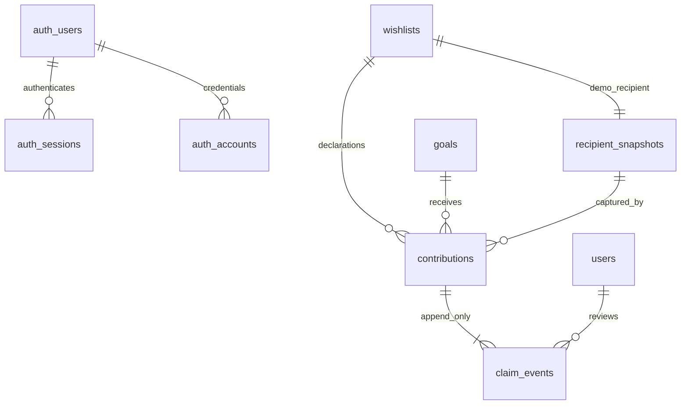

# Current increment: self-hosted accounts and manual gift reports

This supersedes checkpoint-1 statements that auth/reports were absent or that a shared fictional account could be entered. The release target remains a hosted responsive wedding app, **not yet production ready**.

## What changed and why

The user selected a no-gateway direct-to-couple direction: guests declare a payment amount after using UPI, rather than the platform collecting money. A plain QR/redirect/reference/screenshot provides no trustworthy receipt event to this application. Without an approved bank/provider integration, receipt confirmation must remain the couple's manual bank-record check.

The runnable local workflow now implements separate accounts and **synthetic** reporting/confirmation, without a hosted identity, payment, mail, AI or analytics API. It does not generate a real payable UPI QR or process money. Demonstration QR payloads start `DEMO-NOT-PAYABLE|`; wishlist-link QR codes still contain only the local guest URL.

## Authentication

Better Auth **1.7.21**, MIT, stable version selected from registry versions because `latest` was a beta. Official docs verified:

- https://better-auth.com/docs/installation
- https://better-auth.com/docs/adapters/sqlite (explicit Node built-in SQLite support)
- https://better-auth.com/docs/authentication/email-password
- https://better-auth.com/docs/concepts/database (programmatic migration API)

The executed `getMigrations(auth.options).compileMigrations()` output supplied the auth core SQL in migration 002. Real library handlers manage password hashing, verification, sign-in/sign-out, expiry, recovery and session revocation. No hand-rolled password protocol or default administrator credentials.

Local rules: fictional `@example.test` registrations only; 12-128 character passwords; verified email required; generic sign-in/recovery UI and enumeration-resistant signup; sessions one hour with library cookie caching disabled. Cookies are HttpOnly/SameSite=Strict, **not Secure on local HTTP**. Signing out/recovery revokes persisted sessions. Per-email and global database-backed application rate buckets complement library limits.

Verification/recovery use a private `auth_local_outbox` table. **No email is sent.** `npm run auth:mailbox` is a terminal-only credential viewer, never an HTTP endpoint. Links expire under the auth library; new enqueue operations purge outbox rows older than one hour. The launcher generates a persistent secret in ignored `data\local-auth-secret.txt`, never prints it, and passes it server-side. On Windows, POSIX file modes do not substitute for reviewed account/ACL isolation. This local delivery/secrets setup must not be publicly exposed.

`/api/demo-session` POST is retired (410), and old shared-session rows are cleared by migration 002. Old seeded wishlists are not silently transferred to a newly registered owner. Application `users` remain marked synthetic; auth identities are separately stored and mapped by their immutable ID, not display name.

## Actual migrated ER additions

Migration 002 executes atomically through the existing migrator. It adds library auth tables/indexes, local mailbox, immutable recipient snapshots, immutable contribution terms and append-only claim-event triggers. Composite foreign keys enforce goal/recipient/wishlist consistency. All money stays integer paise and INR.

Recipient snapshots in this demo contain only a label copied from the fictional couple name, not a UPI address or payment instrument. Real setup, recipient-name confirmation, reauthentication and versioned recipient changes remain unimplemented.

## Report invariants and states

Amount INR 1 to INR 1,00,000; plain decimal strings with at most two places. Currency mismatch/unknown fields rejected. Optional bounded name/message/reference. A report's amount/goal/currency/recipient/guest text cannot later be edited silently.

A random 256-bit key serves as private status capability and idempotency key. Only its SHA-256 hash and a canonical request hash are stored. Same key/same terms returns the same report, even after a later pause/closure; same key/different terms is 409. This is not permission to initiate a new transfer on retry. The browser stores only that key in sessionStorage for tab-scoped refresh/retry, not name/message.

| From | Allowed next | Confirmed delta |
|---|---|---|
| new declaration | reported, or needs_review for duplicate reference | 0 |
| reported | needs_review, rejected, owner_confirmed | +amount only when confirmed |
| needs_review | rejected, owner_confirmed | +amount only when confirmed |
| owner_confirmed | needs_review | -amount (audited reversal, not a refund) |
| rejected | needs_review | 0 |

Review needs a server-verified authenticated owner, expected version and reason. Confirmation additionally requires an explicit acknowledgement flag. The browser checkbox is not the sole enforcement. Stale/repeated state changes fail; no silent balance adjustment or fake refund button.

Confirmed public demo progress is derived by summing immutable claim-event deltas per goal. Pending/rejected/review reports add zero. Individual names, messages, references and amounts never appear in the public projection. Aggregate changes can still reveal/infer an amount when few gifts exist; no absolute anonymity claim.

Demo overfunding is explicitly simulated: actual confirmed totals remain visible and only the visual bar caps at 100%. **Live hard-cap/overfunding policy remains undecided.**

## Current equivalent API contract

All application mutations still require exact Host/Origin, JSON and a bounded request body. Owner responses are no-store; all pages noindex/no-referrer. Auth verification/recovery links are library-managed token-protected GET ceremonies; app state changes remain POST/PATCH. Next incoming-request logging is disabled to reduce verification/recovery URL leakage; reverse-proxy/host logs still need separate production review.

| Endpoint | Contract |
|---|---|
| `/api/auth/*` | Maintained Better Auth routes, server origin/body/rate guards. Signup restricted to synthetic email addresses, no remote profile image |
| POST `/api/public/wishlists/{slug}/reports` | `{goalId,recipientSnapshotId,amount,currency:"INR",guestName?,guestMessage?,reference?,token}`; validated 256-bit key; returns own receipt/status; no auth required |
| POST `/api/guest/status` | `{token}`; scoped receipt only or uniform 404 for invalid/expired key; max 7-day status capability |
| GET `/api/owner/wishlists/{id}/reports?status=all&page=1` | Owner-only, 50 rows/page plus separate reported/review/owner-confirmed/rejected totals |
| PATCH `/api/owner/wishlists/{id}/reports/{claimId}` | `{status,version,reason,acknowledged?}`; acknowledgement true required for confirmation |
| GET `/api/owner/wishlists/{id}/reports/export` | Owner-only private CSV, up to 5,000 rows, fail rather than partial output above limit; formula-prefix neutralization plus CSV quoting |
| POST `/api/demo-session` | 410, no access grant |

Receipt fields: `id,status,amountPaise,currency,goalTitle,recipientLabel,tokenExpiresAt,mode:"demo"`. Owner list additionally includes optional private guest fields, duplicate-reference warning, version and created UTC. Unknown fields/invalid amount: 422; unavailable/stale/key-conflict: 409; no auth: 401; cross-owner/nonexistent: 404; origin denied: 403; rate limit: 429 with Retry-After.

Private URLs use `/gift-status#<random-key>`: fragment not sent in the server URL. The page reads it only when requested, removes it from the visible URL and uses POST for lookup. No service worker, analytics or remote QR service. Anyone possessing the key can view that one receipt; it must stay private.

## Current requirements-to-tests delta

| IDs | Scenario | Expected | Level | Actual latest completed run |
|---|---|---|---|---|
| AUTH01 | Registration/duplicate signup/unverified login | Generic signup shape, no sign-in before verification; hash not plaintext | Real library + SQLite integration | PASS |
| AUTH02 | Verified sign-in/sign-out/expiry/forged cookie | Persisted-session checks; immediate revoke; expired/invalid denied | Integration | PASS |
| AUTH03 | Recovery/reused token/old session | One successful reset; replay and old session denied | Integration | PASS |
| AUTH04 | Owner A vs B reads/edits/reports | 404 without disclosure | Real separate-account HTTP E2E | PASS |
| CLAIM01 | Unverified report | Pending grows; confirmed stays zero | Unit/integration/E2E | PASS |
| CLAIM02 | Retry/same key/conflicting terms | One record/effect; conflict not duplicate | Integration + concurrent HTTP E2E | PASS, including simultaneous retries |
| CLAIM03 | Duplicate/forged reference | Review warning only; never verifies | Integration | PASS |
| CLAIM04 | Wrong goal/recipient/currency/amount | Reject server-side/constraints | Integration | PASS |
| CLAIM05 | Confirmation/double-confirm/reversal/rejection | Exact audited delta; no negative/double count | Integration/E2E | PASS |
| CLAIM06 | Scoped/random/expired guest token | Own receipt only, 404 otherwise | Integration/E2E | PASS |
| CLAIM07 | Immutability | Terms/recipient/event overwrite/delete denied | Integration | PASS |
| CLAIM08 | CSV formula injection | Dangerous leading formula/whitespace quoted and neutralized | Unit + real CSV endpoint E2E | PASS |
| UI02 | Mobile/desktop, 320/390/768/1280 owner forms, session loss/offline | No checked horizontal overflow; form preserved; report->review->confirm->status works | Browser E2E | PASS |
| ACK01 | Confirmation without explicit acknowledgement | 422, no state change | Browser HTTP E2E | PASS |

Final completed commands: lint passed, strict typecheck passed, **79 unit/integration tests in 5 files passed**, optimized build passed, **6/6 desktop/mobile E2E passed in 31.3 seconds**. Final tests include explicit server-side confirmation acknowledgement, concurrent report retries, separate-account report/export/review denial and disabled legacy entry. The existing seed survived migration 002; expanded backup/isolated restore checks including auth, recipient, contribution and event tables passed. Mobile guest and owner screenshots inspected. No physical-device UPI test or full WCAG/independent completed-code security assessment.

Dependency advisory audit for the new dependency set: **BLOCKED by registry HTTP 429**. The old zero-advisory result is historical and not reused as a claim for Better Auth. No registry policy/configuration was bypassed or changed.

## Remaining release blockers / uncovered risks

PostgreSQL and separate hosted failure domains remain unimplemented. Current local SQLite uses a release-candidate Node driver and is not the hosted production architecture. New accounts/reporting do not authorize deployment.

Live UPI-ID/QR setup, safe QR-image decoding/re-encoding if selected, recipient reauthentication/change history, stale instructions, real external verification/recovery delivery, legal/privacy review, actual retention/deletion, moderation/support, stronger CSP/TLS/Secure cookies, dependency audit clearance, encrypted off-instance backups/restore, load/browser/accessibility/security review and explicit hosting approval remain. No money or screenshots are moved/uploaded, no external messages sent.

Self-hosted open-source auth is free software, not free hosting or a guarantee of security. Local mailbox/SQLite files are readable to trusted filesystem users; library session/verification data follow the library's format (do not assume all tokens are hashed). Keep data, backups and the auth secret out of source control.
