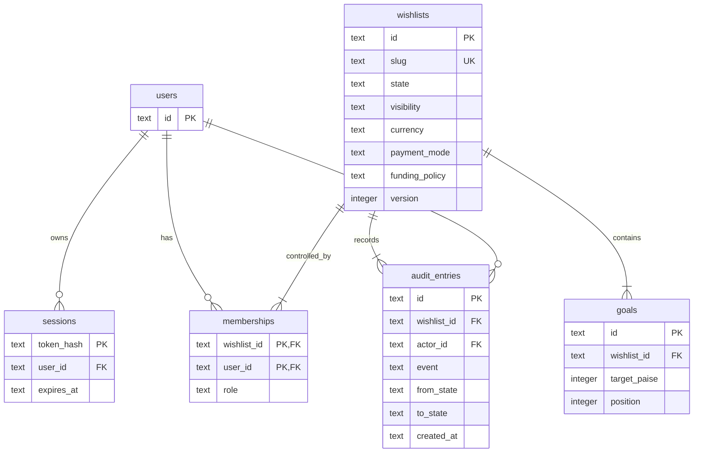
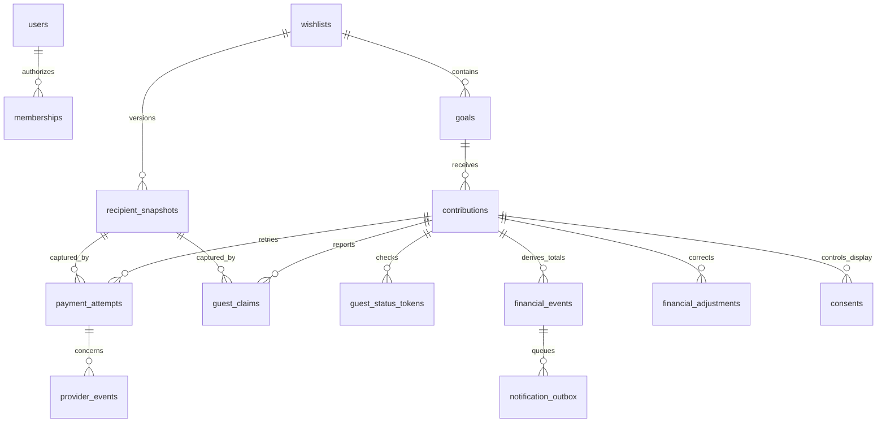

# Schema, invariants and transition specification

Checkpoint-1 schema/design. **Migration 002 and `current-increment.md` add actual maintained-auth, recipient, contribution and claim-event tables. Statements below that those surfaces do not exist are historical, not current implementation claims.**

## Executed slice-1 schema

`migrations/001_demo.sql` is the actual SQLite migration. `schema_migrations` records version and UTC application time; first-use application holds an immediate write transaction and rechecks the version after locking. Runtime enables foreign keys, WAL and a bounded busy timeout. Tables use SQLite STRICT mode.

All timestamps written by this implementation are UTC ISO-8601 with milliseconds. Wedding date is a calendar date, not a timestamp. Inclusive `expiresOn` in Asia/Kolkata is converted to the following midnight IST, stored as exclusive `expires_at`. `now >= expires_at` is expired. Missing expiry means no automatic expiry. The UI labels IST explicitly.

| Invariant | Enforcement |
|---|---|
| Ownership independent of names | Membership foreign keys; owner-filtered server queries for every owner operation |
| INR only, no client owner/mode overrides | Strict input allowlists; currency/payment/funding DB checks |
| Safe exact target | Decimal string parser to paise; integer/range constraints; no binary-floating-point money storage |
| Unique stable share slug | Validated slug syntax and UNIQUE constraint; no slug-edit route |
| No partial draft | Wishlist, membership, ordered goals and audit creation in one transaction |
| Cross-tab state safety | BEGIN IMMEDIATE and expected version check; 409 for stale requests |
| Audit preservation | Append-only triggers; no delete API; filesystem administrators are outside this guarantee |
| No accidental live activation | Only `demo` payment mode accepted; mode/funding updates rejected |
| Public projection | Deliberate fields only; draft/private/archived filtered in the query |
| Zero confirmed progress | No contribution records or payment adapter exist in slice 1; each projection returns zero |

## Actual wishlist state transitions

| From | Allowed next states | Guest view |
|---|---|---|
| draft | published, closed | unavailable |
| published | paused, closed | readable if public/unlisted; available only before expiry |
| paused | published, closed | readable, unavailable for gifting |
| closed | archived | readable, permanently closed |
| archived | none | unavailable; history retained |

Publishing/resuming after expiry is rejected. Publication does not override private visibility. Archiving is not deletion. There is no contribution action in any state yet.

## Future financial schema - design only, NOT migrated or implemented

Required constraints before introducing money:

- Contribution ID is stable across attempts; immutable currency/amount/goal/recipient snapshot. Unique `(owner_or_guest_scope, operation, idempotency_key)` with canonical-request hash; same key/different request is a conflict.
- Provider event unique `(provider, environment, event_id)`. Persist verified event receipt and processing state transactionally before acknowledgement; a replay cannot duplicate a ledger effect. Use exact provider signature rules, not a generic invented algorithm.
- Financial events append-only with unique effect keys. Corrections append reversals/adjustments linked to the original event, actor and reason; never overwrite totals or delete history.
- Refund amount cannot exceed captured minus completed refunds/reserved in-flight refunds; concurrent requests serialize/lock. Failed refund releases reservation without pretending completion.
- Authenticated immutable recipient versions; each instruction, claim and attempt retains the original snapshot. A change requires reauthentication and audit. A stale instruction is visibly flagged.
- Guest tokens use at least 256 bits of randomness; store hashes, scope to one contribution, expire/rotate where appropriate, redact from logs and avoid URL/query leakage. Access design/expiry recovery needs explicit testing.
- Consents separately record essential processing and optional public-display choice. Marketing false by default. Names and exact gift amounts stay private absent explicit permission.
- Database permissions, encryption, key management, backup retention and support actor permissions require a deployment-specific design. SQLite triggers alone are not a financial security boundary.

## Planned direct-UPI claim state table - not executable yet

| State/event | Meaning | Enters owner-confirmed total? |
|---|---|---|
| reported_by_guest | Guest declaration/reference only | No |
| needs_review | Ambiguous/duplicate/stale recipient signal | No |
| confirmed_by_couple | Authenticated owner says bank records match | Yes; label owner-confirmed, not bank-verified |
| rejected | Owner declines declaration | No |
| confirmation_reversed | Audited correction to mistaken confirmation | Removes prior owner-confirmed effect exactly once |

UPI launch/return, entered reference, screenshot and "I paid" are not verification. Duplicate references are review signals only. The platform never processed the transfer and cannot offer a platform refund button. No bank statements/screenshots in the MVP.

## Planned provider states - provider-independent concepts, not final mapping

| Concept | Financial interpretation |
|---|---|
| created / pending / authorized | Not confirmed captured money |
| captured, authoritative event/status checked | Provider-confirmed gross, subject to refund/dispute state |
| settled / payout_completed | Separate recipient availability metrics, never counted twice |
| failed / cancelled | No confirmed amount; later authoritative success must reconcile rather than be discarded |
| refund_requested / refund_pending / refund_failed | Do not pretend a completed refund; track in-flight liability separately |
| refund_completed | Reduce eligible confirmed amount by the actual completed amount |
| disputed / chargeback | Remove contested amount from eligible confirmed progress; show contested total separately |
| settlement_failed / payout_failed | Separate operational status; not a new gift or silent money loss |

Select only states the chosen approved provider actually supports, then document exact mappings. Browser callbacks cannot update financial truth.

Proposed derived dashboard metrics: reported pending, owner-confirmed net, provider-confirmed eligible net, refunded, disputed and settled/payout totals are separate. A contribution can contribute to one confirmation source, not both. Count only the selected source's valid net effects; contested/pending/failed never inflate confirmed progress. Fees/taxes/gross/net and whose amount counts remain undecided; do not activate until specified.

Overfunding is undecided. If allowed, show actual confirmed amount above the target while capping only the visual bar. If hard caps are selected, implement goal reservations with TTL and serialized allocation, plus an explicit late-success excess/refund policy. A database reservation cannot atomically guarantee a cross-system provider cap; never promise otherwise.
